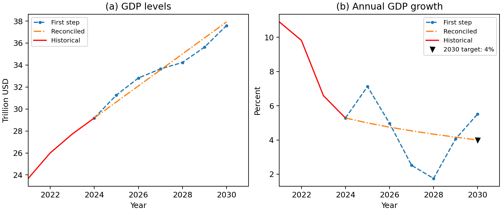
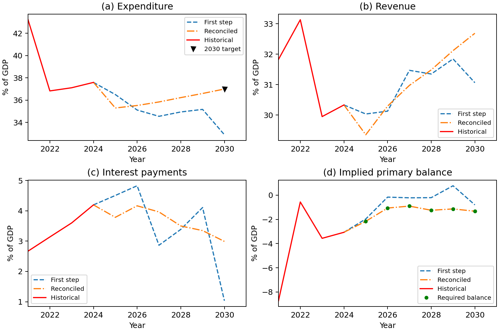

Examples
--------

These examples show how to incorporate economic constraints into forecasts.
The GDP example introduces the workflow with a single growth target. The fiscal
example extends it to several variables linked by an accounting identity,
while the final example shows how to apply reconciliation to forecasts from
another model or from expert judgment.

.. _gdp-example:

GDP forecasting with a growth target
~~~~~~~~~~~~~~~~~~~~~~~~~~~~~~~~~~~~

This example forecasts US nominal GDP for 2025-2030 with an illustrative
terminal growth target of 4 percent. The bundled data contain annual observations
for 1950-2024 in **trillions of US dollars**, followed by six missing values
to forecast.
No data download is needed. Install the repository checkout with
``python -m pip install -e .``, then run:

.. code-block:: python

   import numpy as np
   from sklearn.linear_model import LinearRegression
   from sktime.forecasting.compose import make_reduction
   from macroframe_forecast import MFF
   from macroframe_forecast.examples import generate_example_GDP_df

   data = generate_example_GDP_df()
   model = MFF(
       data,
       forecaster=make_reduction(
           LinearRegression(), strategy="direct", window_length=6,
       ),
       equality_constraints=["GDP_2030 - 1.04 * GDP_2029"],
       parallelize=False,
   )
   forecasts = model.fit()
   growth_2030 = 100 * (forecasts.loc[2030, "GDP"] / forecasts.loc[2029, "GDP"] - 1)
   print(f"Reconciled GDP growth in 2030: {growth_2030:.4f}%")
   np.testing.assert_allclose(growth_2030, 4.0, rtol=0, atol=1e-8)

.. code-block:: text

   Reconciled GDP growth in 2030: 4.0000%

The constraint rewrites ``GDP_2030 / GDP_2029 - 1 = 0.04`` as a linear
expression equal to zero. ``model.df1`` contains the first-step forecasts;
``forecasts`` (also available as ``model.df2``) contains the reconciled values.
Both include the historical data.

The first stage fits a separate ordinary least squares regression for each
forecast horizon, using the six most recent observed GDP values as predictors.
This is direct autoregressive forecasting: each horizon has its own fitted
coefficients. The first-stage regressions do not use the 4 percent target.
MFF then estimates forecast-error weights and smoothing parameters from
historical backtests and reconciles the forecasts. No smoothing parameter is
specified in this example.

Compare annual growth before and after reconciliation:

.. code-block:: python

   import pandas as pd

   growth_comparison = pd.DataFrame({
       "First step": model.df1["GDP"],
       "Reconciled": forecasts["GDP"],
   }).pct_change(fill_method=None) * 100
   print(growth_comparison.loc[2025:2030].round(2).to_string())

.. code-block:: text

         First step  Reconciled
   year
   2025        7.12        4.99
   2026        4.98        4.75
   2027        2.52        4.53
   2028        1.75        4.34
   2029        4.06        4.16
   2030        5.52        4.00

The first-step growth rates vary across forecast years. Reconciliation smooths
GDP levels within the forecast horizon and meets the terminal target, changing
2030 growth from about 5.52 percent to 4 percent. The historical observations
remain unchanged.

Plot the levels and annual growth rates using the fitted model. Run this block
in the same session; it also saves ``gdp_forecasts.png`` in the current directory.

.. code-block:: python

   import matplotlib.pyplot as plt
   import pandas as pd

   levels = pd.DataFrame({
       "First step": model.df1["GDP"],
       "Reconciled": forecasts["GDP"],
       "Historical": data["GDP"],
   })
   # Calculate growth before selecting the plotting window, without filling NaNs.
   growth = levels.pct_change(fill_method=None) * 100
   fig, axes = plt.subplots(1, 2, figsize=(9, 3.8), layout="constrained")
   for ax, series, title, units in zip(
       axes, [levels, growth], ["(a) GDP levels", "(b) Annual GDP growth"],
       ["Trillion USD", "Percent"],
   ):
       ax.plot(series["First step"].loc[2024:], "--o", markersize=3, label="First step")
       ax.plot(series["Reconciled"].loc[2024:], "-.", label="Reconciled")
       ax.plot(series["Historical"].loc[2021:2024], color="red", label="Historical")
       ax.set(title=title, xlabel="Year", ylabel=units, xlim=(2021, 2031))
       ax.set_xticks([2022, 2024, 2026, 2028, 2030])
   axes[1].plot(2030, 4, "v", color="black", label="2030 target: 4%")
   for ax in axes:
       ax.legend(fontsize=8)
   fig.savefig("gdp_forecasts.png", dpi=180)
   plt.show()

   US nominal GDP forecasts for 2025-2030. Source: IMF April 2025 World Economic
   Outlook example and package calculations.

The self-contained :download:`reproduction script <../../paper/reproduce_figures.py>`
generates this figure, saves both forecast stages, and verifies the terminal
target and preservation of historical observations. From the repository root,
run ``python paper/reproduce_figures.py``. Outputs are saved in
``build/paper-figures/``; the
:download:`reproduction instructions <../../paper/README.md>` describe the files.

The following fiscal example extends the workflow to constraints linking
several variables.

.. _fiscal-walkthrough:

Fiscal forecasting walkthrough
~~~~~~~~~~~~~~~~~~~~~~~~~~~~~~

Suppose we know the primary-balance path for the United States through 2030,
while expenditure, revenue, and interest payments still need to be forecasted.
We also want expenditure to reach 37 percent of GDP in 2030. Forecasting each
series separately does not guarantee that the results satisfy those conditions.
This example shows how MFF adjusts the forecasts jointly.

All quantities below are percentages of GDP. Run the Python blocks in order in
one session. They include all required imports and use bundled data, without
an external download. To use the new example helper, install this repository
checkout from its root before starting:

.. code-block:: console

   python -m pip install -e .

Load the data
^^^^^^^^^^^^^

.. code-block:: python

   import numpy as np
   import pandas as pd
   from sklearn.linear_model import LinearRegression
   from sktime.forecasting.compose import DirectReductionForecaster
   from macroframe_forecast import MFF
   from macroframe_forecast.examples import generate_example_fiscal_df

   data = generate_example_fiscal_df()
   print(data.loc[2024:2026].to_string())

.. code-block:: text

            exp     rev  int_payments     pb
   year
   2024  37.593  30.331         4.195 -3.067
   2025     NaN     NaN           NaN -2.158
   2026     NaN     NaN           NaN -1.063

The index identifies the year. ``exp`` is expenditure, ``rev`` is revenue,
``int_payments`` is interest payments, and ``pb`` is the primary balance.
Observations run from 2001 through 2024. The missing values (``NaN``) tell MFF
which cells to forecast for 2025-2030. The primary-balance values remain filled
because they are the prescribed path, not an additional forecast target.

Specify the constraints
^^^^^^^^^^^^^^^^^^^^^^^

The primary balance equals revenue minus expenditure plus interest payments.
Moving every term to the left gives the expression MFF expects to equal zero:

.. code-block:: python

   constraints = [
       "pb_? - rev_? + exp_? - int_payments_?",
       "exp_2030 - 37",
   ]

The wildcard ``?`` applies the accounting identity across forecast years. The second
expression applies only in 2030. The supplied primary-balance values enter the
identity as known quantities; MFF adjusts the other three variables to satisfy
it. Constraint strings contain expressions, without an ``= 0`` suffix.

Fit and reconcile the forecasts
^^^^^^^^^^^^^^^^^^^^^^^^^^^^^^^

.. code-block:: python

   model = MFF(
       data,
       forecaster=DirectReductionForecaster(LinearRegression()),
       equality_constraints=constraints,
       parallelize=False,
   )
   reconciled = model.fit()
   first_step = model.df1

This example explicitly selects ordinary least squares (OLS), with direct
forecasting for each horizon. The first stage produces forecasts independently
of the accounting constraints. MFF then estimates forecast-error weights and
smoothing parameters from historical backtests and jointly reconciles the
forecasts. ``first_step`` contains the initial forecasts, while ``reconciled``
contains the final values. Both retain the historical observations.

Inspect the results
^^^^^^^^^^^^^^^^^^^

.. code-block:: python

   variables = ["exp", "rev", "int_payments"]
   comparison = pd.DataFrame({
       "First step": first_step.loc[2030, variables],
       "Reconciled": reconciled.loc[2030, variables],
   })
   print(comparison.round(2).to_string())

.. code-block:: text

                 First step  Reconciled
   exp                32.90       37.00
   rev                31.06       32.69
   int_payments        1.03        2.99

Expenditure reaches the required 37 percent of GDP. Revenue and interest
payments change as well: all three adjustments must be consistent with the
prescribed primary balance. At the displayed precision, the 2030 balance is
``32.69 - 37.00 + 2.99 = -1.32`` percent of GDP; the unrounded result matches the
supplied value of ``-1.324``.

   First-step and reconciled US fiscal forecasts, in percent of GDP.
   Source: IMF April 2025 World Economic Outlook example and package calculations.

The blue dashed lines show the first-stage OLS forecasts; the orange lines show
the reconciled forecasts. The final paths are smoother across the forecast
years, particularly for expenditure and interest payments. The black triangle
marks the expenditure target. In the primary-balance panel, each line is
calculated as ``rev - exp + int_payments`` so that we can compare the implied
balance with the green points showing the required path.

These outputs were generated with Python 3.14.7, NumPy 2.3.5, pandas 2.3.3,
SciPy 1.17.1, scikit-learn 1.7.2, and sktime 0.40.1. Numerical results can vary
with dependency versions.

Verify the conditions
^^^^^^^^^^^^^^^^^^^^^

.. code-block:: python

   years = slice(2025, 2030)
   first_balance = first_step["rev"] - first_step["exp"] + first_step["int_payments"]
   final_balance = reconciled["rev"] - reconciled["exp"] + reconciled["int_payments"]
   first_error = (first_balance - data["pb"]).loc[years].abs().max()
   final_error = (final_balance - data["pb"]).loc[years].abs().max()
   print(f"Largest first-step balance error: {first_error:.4f}")
   print(f"Largest reconciled balance error: {final_error:.4f}")

   np.testing.assert_allclose(final_balance.loc[years], data.loc[years, "pb"], rtol=0, atol=1e-8)
   np.testing.assert_allclose(reconciled.loc[2030, "exp"], 37, rtol=0, atol=1e-8)
   pd.testing.assert_frame_equal(reconciled.loc[:2024], data.loc[:2024])
   pd.testing.assert_series_equal(reconciled["pb"], data["pb"])

.. code-block:: text

   Largest first-step balance error: 1.9161
   Largest reconciled balance error: 0.0000

Errors are in percentage points of GDP. The assertions check both constraints
within numerical tolerance and confirm that historical values and the supplied
primary-balance path are unchanged.

Reproduce the figure
^^^^^^^^^^^^^^^^^^^^

The complete :download:`reproduction script <../../paper/reproduce_figures.py>`
uses the same data and model, includes the plotting code, and saves the figure,
forecast values, and dependency versions. From the repository root, run:

.. code-block:: console

   python paper/reproduce_figures.py --example fiscal

The outputs appear in ``build/paper-figures/``. See the
:download:`reproduction instructions <../../paper/README.md>` for details.
To refresh the documentation image after regenerating the figure, copy
``build/paper-figures/fiscal_forecasts.png`` to
``docs/source/_static/fiscal_forecasts.png``.

.. _external-forecasts:

Advanced: reconcile externally supplied forecasts
~~~~~~~~~~~~~~~~~~~~~~~~~~~~~~~~~~~~~~~~~~~~~~~~~

You can use the reconciliation step without fitting an ``MFF`` model. For
example, the GDP forecasts below might come from another model or from expert
judgment. This block runs independently of the examples above and includes
all imports and inputs.

.. code-block:: python

   import numpy as np
   import pandas as pd
   from macroframe_forecast.utils import GenSmoothingMatrix, Reconciliation

   # One entry for each (variable, year), in trillions of USD.
   cells = pd.MultiIndex.from_product([["GDP"], range(2025, 2031)])
   initial = pd.Series([29.0, 31.5, 33.0, 34.1, 36.8, 39.0], index=cells)

   # Identity weights give each forecast the same weight.
   weights = pd.DataFrame(np.eye(len(cells)), index=cells, columns=cells)
   smoothness = pd.Series([100.0], index=[cells])
   penalty = GenSmoothingMatrix(weights, smoothness)

   # GDP_2030 - 1.04 * GDP_2029 = 0, in matrix form C @ y = d.
   C = pd.DataFrame([[0.0, 0.0, 0.0, 0.0, -1.04, 1.0]],
                    index=["terminal_growth"], columns=cells)
   d = pd.DataFrame([0.0], index=C.index)
   result = Reconciliation(initial, weights, penalty, C, d)

   comparison = pd.DataFrame({"Supplied": initial, "Reconciled": result.iloc[:, 0]})
   print(comparison.xs("GDP").round(2).to_string())
   np.testing.assert_allclose(C.to_numpy() @ result.to_numpy(), d.to_numpy(), rtol=0, atol=1e-8)

.. code-block:: text

         Supplied  Reconciled
   2025      29.0       30.07
   2026      31.5       31.65
   2027      33.0       33.22
   2028      34.1       34.76
   2029      36.8       36.27
   2030      39.0       37.72

Here the weight matrix and smoothing parameter are explicit illustrative
choices, rather than estimates from backtesting. ``GenSmoothingMatrix`` builds
the penalty, and ``Reconciliation`` uses that penalty and those weights to
adjust the supplied forecasts subject to the terminal growth constraint.
The row and column ordering must agree across the forecast vector, weights,
penalty, and constraint matrix. Increasing the smoothing parameter places
more weight on reducing changes in the slope of the forecast path; zero
removes that penalty.
